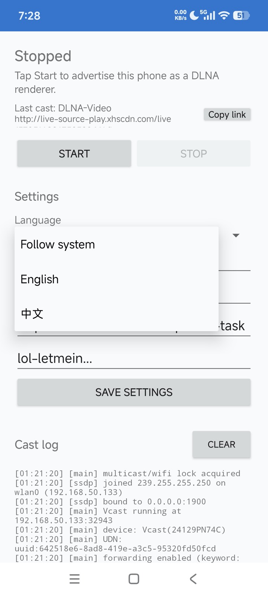
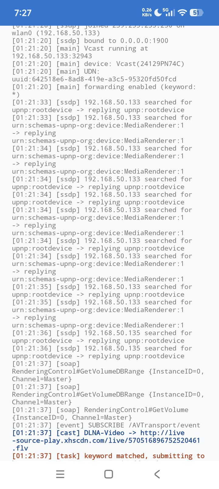

# Vcast

English | [简体中文](README.md)

[](https://github.com/iwestlin/vcast/releases)
[](https://github.com/iwestlin/vcast/actions/workflows/android.yml)
[](LICENSE)

Vcast is an Android DLNA/UPnP Media Renderer. Once the service is running, players on the same LAN can cast media to this phone (you can even enable a hotspot and cast to the phone itself over a cellular network). Vcast matches casts by a URL regex and forwards matching tasks to a configured HTTP endpoint.

## Screenshots

| Settings | Logs |
| --- | --- |
|  |  |

## Features

- DLNA MediaRenderer: AVTransport, RenderingControl, ConnectionManager
- SSDP advertising, HTTP/SOAP/GENA, foreground service
- Custom device name
- English and Chinese UI, following the system or manually switchable
- Match casts by cast URL regex; `*` matches everything
- Forward `{room, passkey, title?, extra?}` JSON
- Last cast link is truncated and can be copied with one tap
- Cast log and HTTP response log, with key events highlighted
- Custom endpoint, passkey, or keyword

## Quick Start

1. Install and open Vcast; on Android 13+, grant notification permission so the foreground service notification can be shown.
2. Enter the HTTP URL that receives tasks in Task endpoint, set the cast URL regex and passkey as needed, then start the service.
3. On the same LAN, open a DLNA-capable player and select the Vcast device to cast.
4. Matched tasks are POSTed as JSON to your configured endpoint.

## Settings

| Field | Description |
| --- | --- |
| Language | Follow system, English, or Chinese |
| Device name | Name shown on the local network |
| Regex for cast URL | Case-insensitive regex for the cast URL; `*` matches everything |
| Task endpoint | HTTP URL that receives matched tasks |
| Passkey | Optional; sent as the `passkey` field |

Restart the service after changing device or task settings. Restart the service after changing the language to update notification text.

## Payload

`room` is the matched cast URL. `title` is sent only when the media metadata contains `dc:title`. `extra` contains the raw DIDL metadata and common parsed fields.

```js
{
  "room": "http://example.com/video.mp4",
  "passkey": "", // optional; set a custom passkey to verify requests are genuine
  "title": "Example",
  "extra": {
    "metadata": "<DIDL-Lite ...>",
    "creator": "Example Creator",
    "artist": "Example Artist",
    "duration": "0:01:30.000"
  }
}
```

## FAQ

- **The player cannot find the device**: Make sure the phone and player are on the same LAN and AP isolation is disabled; some routers require multicast/IGMP to be enabled.
- **No LAN but still want to cast**: Enable the phone's hotspot, connect the player to it, and cast to the phone itself.
- **Settings changes do not take effect**: Stop and restart the service.
- **Tasks are not forwarded**: Check that the endpoint is reachable, the cast URL regex matches (`*` matches everything), and the passkey matches the receiver.

## Privacy

Vcast does not collect or upload any data. Settings stay on the device, cast links and metadata are only sent to the endpoint you configure, and logs are kept in memory only.

## Build

Requires JDK 17 and Android SDK 35.

```bash
./gradlew assembleDebug
```

APK output:

```text
app/build/outputs/apk/debug/app-debug.apk
```

Install:

```bash
adb install -r app/build/outputs/apk/debug/app-debug.apk
```

## GitHub Actions

- Pushing changes to `app/**`, Gradle configuration, or the workflow on `master`/`main` builds the APK and uploads it as an Actions artifact.
- Pushing a `v*` tag builds and publishes a GitHub Release with `vcast.apk` as the asset.

```bash
git tag -a v1.0.1 -m "Vcast v1.0.1"
git push origin v1.0.1
```

## Package

`com.viegg.vcast`

## Acknowledgements

This project was inspired by https://github.com/xfangfang/Macast

## License

[MIT](LICENSE)
